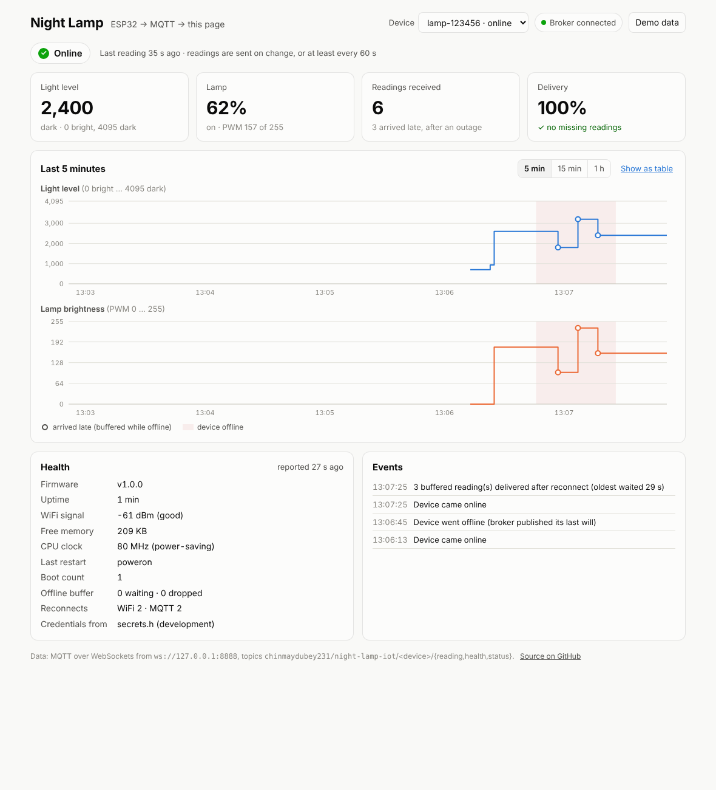
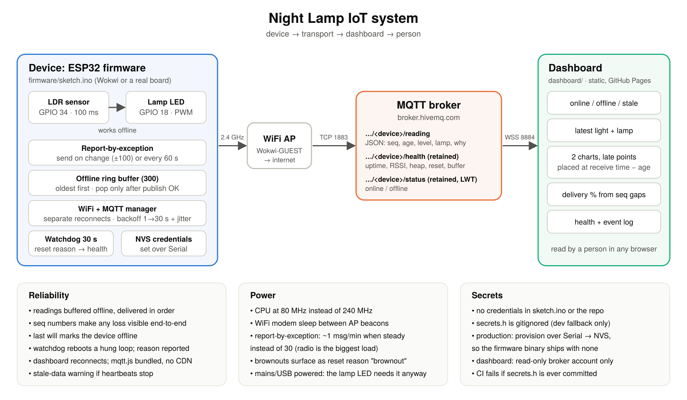

# Night Lamp IoT System (Task 04, Capstone)

A complete IoT chain, from a sensor to a page a person reads:

**ESP32 firmware** (light sensor + lamp) → **MQTT** over WiFi → **live web dashboard** in the browser.

The capstone of a four-part series: [01 sensor + actuator](https://github.com/ChinmayDubey231/light-sensor-night-lamp) · [02 non-blocking timers](https://github.com/ChinmayDubey231/non-blocking-night-lamp) · [03 network + offline buffer](https://github.com/ChinmayDubey231/connected-night-lamp) · **04 this repo**.

**Live dashboard:** <https://chinmaydubey231.github.io/night-lamp-iot-system/>. Press **Demo data** if no device is running.


*The dashboard after a 40 s WiFi outage. Readings taken while offline arrive late, are plotted at the time they were taken (hollow markers), and the delivery tile confirms nothing was lost. This was captured from the [end-to-end run](#tests): real firmware logic → real MQTT broker → this page.*

## What the brief asks for

| Requirement | Where |
|---|---|
| **Device, transport and a dashboard** | [`firmware/`](firmware/) ESP32 sketch → MQTT topics `…/<device>/reading`, `…/health`, `…/status` on a broker → [`dashboard/`](dashboard/) static page subscribing over MQTT-over-WebSockets |
| **Power and reliability considered** | [Power](#power) (80 MHz CPU, modem sleep, report-by-exception, measured trade-offs) and [Reliability](#reliability) (offline buffer, reconnect backoff, last will, watchdog, reset reasons, health reports, gap detection) |
| **Secrets kept out of the firmware** | [Secrets](#secrets): credentials come from device storage (NVS), set over Serial, or a gitignored `secrets.h` for development. A CI check fails the build if any are committed. |
| **System diagram** | Below, and [`docs/system-diagram.svg`](docs/system-diagram.svg) |



## Run it

### 1. Open the dashboard

Open the [live dashboard](https://chinmaydubey231.github.io/night-lamp-iot-system/), or open `dashboard/index.html` locally. It has no build step and no backend. It connects to `wss://broker.hivemq.com:8884/mqtt` and shows any device publishing under `chinmaydubey231/night-lamp-iot/`. With no device running, press **Demo data**: a simulated device runs in the browser, clearly labelled, including an outage with late readings.

### 2. Start the device (Wokwi simulator, no hardware)

1. Open <https://wokwi.com/projects/new/esp32>.
2. Paste [`firmware/sketch.ino`](firmware/sketch.ino) into `sketch.ino` and [`firmware/diagram.json`](firmware/diagram.json) into `diagram.json`.
3. Add two files (the **▾** next to the tabs → *New file…*):
   - `libraries.txt` containing `PubSubClient`
   - `secrets.h` with the contents of [`firmware/secrets.example.h`](firmware/secrets.example.h). This is the step that keeps secrets out of the repo: you create the file locally and it is never committed.
4. Press **▶ Start**. Within a few seconds the dashboard shows the device **Online**, with its health panel filled in.
5. Move the light slider: a reading arrives within 2 s. Press **drop network** to cut WiFi for 20 s: the dashboard turns **Offline**, then the buffered readings arrive late and are plotted at the time they were taken.

Keep the Wokwi tab visible while it runs. Browsers pause background tabs, and the simulation pauses with them.

### On a real ESP32

Wire it as in Task 03 (LDR divider on GPIO 34, LED + 220 Ω on GPIO 18, button on GPIO 4). Copy `secrets.example.h` to `secrets.h`, install **PubSubClient**, and upload with *ESP32 Dev Module*. For a build with no secrets at all, leave `secrets.h` empty and provision over Serial (115200 baud):

```
ssid MyHomeWiFi
pass my-wifi-password
reboot
```

`show` prints the settings with passwords masked, and `forget` erases them.

## How it works

| Topic | Payload | Retained |
|---|---|---|
| `chinmaydubey231/night-lamp-iot/<device>/reading` | `{"seq":4,"t":46003,"age":29001,"level":1800,"lamp":98,"why":"change"}` | no |
| `…/<device>/health` | `{"fw":"1.0.0","up":75,"rssi":-61,"heap":214000,"cpu":80,"reset":"poweron","boots":1,"buffered":0,"dropped":0,…,"creds":"nvs"}` | yes |
| `…/<device>/status` | `online`, or `offline` from the broker as the last will | yes |

- **`seq`** increases by one per reading, so the dashboard can show gaps (lost data) and ignore duplicates.
- **`age`** is how long the reading waited in the offline buffer. The dashboard plots each reading at *arrival time − age*. The device needs no clock for this, and late readings land at the right time.
- **`why`** is `boot`, `change` or `heartbeat`, which explains why a reading was sent.
- **Health is retained,** so a dashboard opened later immediately shows the last known state. It is a snapshot, so it is never buffered; only readings are history.
- **Device IDs** come from the MAC address (`lamp-123456`). The simulator has no factory MAC, so there they are random.

## Power

The lamp LED is the device's whole purpose and must react within 100 ms, so this device runs from USB or mains, not a battery. Power work went into not wasting energy around that:

| Measure | Effect |
|---|---|
| **CPU at 80 MHz** instead of the default 240 MHz | ESP32 datasheet, modem-sleep: **20–31 mA at 80 MHz vs 30–68 mA at 240 MHz** (dual-core chip). This is the biggest saving here, and 80 MHz is the lowest clock that still runs WiFi. |
| **WiFi modem sleep** (`WiFi.setSleep(true)`) | The radio sleeps between the access point's beacons instead of listening all the time (WiFi receive is about 95–100 mA). |
| **Report-by-exception** | A reading is sent only when the light changes by about 2.5% or the lamp switches, plus a 60 s heartbeat. With steady light that's **1 message a minute instead of 30**. Each WiFi transmit burst peaks around 240 mA, so fewer, rarer transmissions mean less radio time (and less broker and network load). |
| **Brownouts made visible** | If the supply sags, the ESP32's brownout detector resets it, and the next health report says `reset: "brownout"`. The dashboard flags it, so a weak power supply shows up as data rather than mystery reboots. |

**Why not deep sleep?** Deep sleep would cut the chip to microamps, but it stops the PWM that drives the lamp and makes the device unreachable. For a *battery-powered sensor-only* variant (no lamp), the right design is different: deep sleep, wake every few minutes, keep readings in RTC memory, send them in one burst, then sleep again. Even then, an always-on WiFi connection at about 20–30 mA would empty a 2000 mAh cell in roughly 3 days, which is why that variant would have to sleep.

Datasheet figures as summarised by [Arrow](https://www.arrow.com/en/research-and-events/articles/esp32-power-consumption-can-be-reduced-with-sleep-modes) and [JLCPCB](https://jlcpcb.com/blog/esp32-power-consumption-explained). These are chip figures; a dev board's USB chip and regulator add more.

## Reliability

| Failure | What happens |
|---|---|
| WiFi drops | Readings go into a 300-slot RAM ring buffer. WiFi retries immediately, then backs off (2, 4, 8 … 30 s, with jitter). On reconnect the backlog is sent oldest-first. Each reading is removed only after `publish()` succeeds, so a connection that dies mid-backlog loses nothing. |
| Broker down, WiFi fine | MQTT retries on its own backoff (1, 2, 4 … 30 s) without restarting WiFi. |
| Device vanishes | The broker publishes the retained last will `offline`, so the dashboard shows **Offline** instead of silently going quiet. |
| Device online but silent | The dashboard shows **Online, but no data** once no message has arrived for more than two heartbeats. |
| Firmware hangs | The 30 s task watchdog reboots the board. The next health report says `reset: "task_watchdog"` and the boot count goes up, both visible on the dashboard. |
| Outage longer than 10 minutes | The oldest readings are dropped (the newest data is more useful) and counted in `dropped`. The `seq` gap makes the loss visible end-to-end, and the dashboard's **Delivery** tile reports it. |
| Dashboard loses the broker | mqtt.js reconnects every 3 s. The library is bundled with the page rather than loaded from a CDN, so a CDN outage can't break the dashboard. |

## Secrets

- **Nothing secret is in `sketch.ino` or the repository.** The firmware reads credentials from NVS (the ESP32's non-volatile storage) first, and only falls back to `secrets.h` for development.
- **`firmware/secrets.h` is gitignored.** [`secrets.example.h`](firmware/secrets.example.h) shows the format. The sketch stops with a clear `#error` if the file is missing, rather than building with blanks.
- **Production builds ship with no credentials at all.** You provision each board over Serial (`ssid`, `pass`, `mqttuser`, `mqttpass`, then `reboot`), and the values live only in that board's flash. `show` masks passwords. Health reports only *where* credentials came from (`creds: "nvs"`), never the values.
- **The dashboard holds no secret.** Anything shipped to a browser is readable by whoever opens it. On a private broker, the dashboard gets its own **read-only** account (an ACL allowing subscribe and nothing else), so a leaked login can't publish or control devices. See [`dashboard/config.js`](dashboard/config.js).
- **CI enforces it.** [`tools/check_secrets.sh`](tools/check_secrets.sh) fails the build if `secrets.h` is committed, if credentials are defined in the firmware source, if the dashboard config has a password, or if anything shaped like an API key, token or private key is tracked.

The public HiveMQ broker used for the demo has no credentials, so anyone can run this in one click. For a real deployment, the next step is a private broker with TLS (port 8883, `WiFiClientSecure` with the broker's root CA) and per-device usernames, provisioned the same way.

## Tests

Three kinds, all run by [CI](.github/workflows/ci.yml) on every push:

**1. Firmware unit tests:** [`firmware/test/`](firmware/test/). The real `sketch.ino` is compiled on a PC against small fakes of the ESP32 APIs (WiFi, PubSubClient, Preferences/NVS, task watchdog, reset reasons). It's built twice, once for each watchdog API generation: Arduino-ESP32 2.x and 3.x.

```
./firmware/test/run_tests.sh
```

They check:
- **Power settings:** 80 MHz and modem sleep.
- **Watchdog:** configured, and fed on every loop pass.
- **Reporting:** report-by-exception (5 heartbeats in 5 steady minutes rather than 150 readings; a flicker inside the deadband is ignored; a real change is sent within about 1.3 s).
- **Outages:** buffering and in-order delivery after a WiFi outage, even when the link dies mid-backlog, and MQTT re-establishing its session.
- **Provisioning:** over Serial into NVS (taking priority over `secrets.h`), with passwords masked.
- **Health and reset reasons:** health contents, and how watchdog and brownout resets are reported.

42 checks.

**2. End-to-end:** [`tools/e2e/`](tools/e2e/). The real firmware logic runs in real time on the PC. Every MQTT action it takes (connect with last will, publish, connection lost) is replayed on a real local MQTT broker ([aedes](https://github.com/moscajs/aedes), with WebSockets). The script dims the light, kills WiFi from 35 s to 75 s while the light keeps changing, then restores it. An independent subscriber records what reached the broker and checks it:

```
./tools/e2e/run.sh            # then open dashboard/index.html?broker=ws://localhost:8888
```

```
End-to-end result:
  ok   readings arrived (6)
  ok   every reading once, in order (seq 1..6)
  ok   buffered readings delivered after the outage (3)
  ok   broker published the last will "offline" during the outage
  ok   device came back "online" by itself
  ok   health snapshots published (2)
```

The broker's view of that run is in [`docs/e2e-broker-log.txt`](docs/e2e-broker-log.txt). The screenshots in this README are the dashboard watching that same run ([during the outage](docs/dashboard-during-outage.png), [after it](docs/dashboard-after-outage.png)).

**3. Secrets check:** `./tools/check_secrets.sh`.

## Decisions

- **No backend.** The broker already is the backend for live data, and the dashboard subscribes directly over secure WebSockets. That means one less service to run, secure and pay for, and the page can be hosted free on GitHub Pages. The trade-off is that history only covers what the open page has seen (plus retained health and status). Long-term history would need a small subscriber writing to a time-series database, which is the natural next piece.
- **Plain HTML, CSS and JS, no framework or build.** It's one page with a few panels. Anyone can open `index.html` and it works.
- **Two stacked charts, not one with two y-axes.** Light (0–4095) and lamp brightness (0–255) have different scales, and a dual-axis chart invites false comparisons. Both charts share the time axis and one crosshair. They are step charts, because with report-by-exception a value holds until the next reading.
- **Late readings plotted at the time they were taken.** If they were plotted at arrival time, an outage would look like a burst of activity at the moment of reconnection, which is the opposite of what happened.
- **Health is not buffered.** A ten-minute-old snapshot of RSSI or heap is noise. Readings are the history; health is "how is it now".
- **Retained `status` and `health`.** A dashboard opened at any time immediately shows the last known state.
- **One hardware timer is enough.** Unlike Task 02, nothing here needs an exact rate. `millis()` timers that skip ahead (rather than bursting) after the one blocking call, `mqtt.connect()`, are simpler and keep Timer1 free.

## Repository layout

```
firmware/
  sketch.ino            ESP32 firmware
  secrets.example.h     copy to secrets.h (gitignored)
  diagram.json          Wokwi circuit
  libraries.txt         Wokwi libraries
  test/                 unit tests + fake ESP32 APIs + e2e bridge
dashboard/
  index.html            the dashboard (open directly, or GitHub Pages)
  app.js, style.css
  config.js             broker URL and topics; no secrets
  vendor/mqtt.min.js    mqtt.js 5.10.1 (MIT), bundled
docs/
  system-diagram.svg/.png
  dashboard-*.png       screenshots
  e2e-broker-log.txt    broker log from the end-to-end run
tools/
  check_secrets.sh      secret scanner (CI)
  e2e/                  end-to-end runner (local MQTT broker)
.github/workflows/
  ci.yml                unit tests, secrets check, end-to-end
  pages.yml             deploys dashboard/ to GitHub Pages
```
